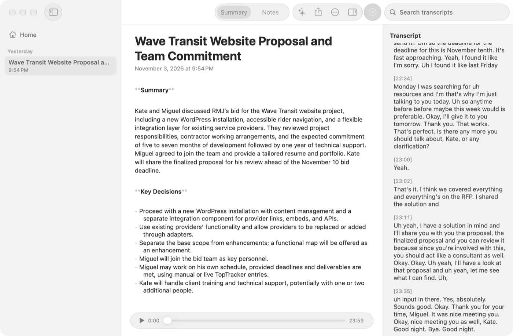

<div align="center">
    
    <h3>Privacy-first AI meeting assistant for macOS</h3>
</div>

Meety records your meetings, transcribes them live on your Mac, and writes summaries with a local model or the provider you choose. Audio and transcription never leave the machine. If you pick a cloud provider for summaries, only the transcript text is sent to it.

This fork is a native Swift + AppKit app (macOS 26, Apple Silicon). It replaced the Tauri app (Rust core + Next.js UI) on the `enhance/swift-port` branch; see [docs/SWIFT_PORT_PLAN.md](docs/SWIFT_PORT_PLAN.md) for the decisions and what was dropped. Forked from [Zackriya-Solutions/meetily](https://github.com/Zackriya-Solutions/meetily).

## Features

- Records microphone and system audio (Core Audio process tap), with pause, resume and device switching
- Live transcription on the Neural Engine with Parakeet (Ultra, Phonon-2), or Whisper large-v3-turbo for Tagalog and Taglish
- Summaries from a built-in llama.cpp model, Ollama, Claude, OpenAI, Groq, OpenRouter, a custom OpenAI-compatible endpoint, or ChatGPT through the Codex CLI; templates, custom prompts and summary language
- Meetings list with transcript search, playback with click-to-seek, markdown summary and notes editors
- Import audio files and retranscribe meetings with another model or language
- Menu bar item, notifications, first-launch onboarding; API keys in the Keychain

## Build and run

Requires Xcode 27 and [XcodeGen](https://github.com/yonaskolb/XcodeGen).

```bash
cd macos
scripts/test.sh       # MeetyKit logic tests (swift test) + a Debug app build
scripts/build.sh      # Debug build into macos/build.noindex/DerivedData
scripts/package.sh    # signed Release build into macos/build.noindex/Meety.app
```

`package.sh` signs with the first Developer ID Application identity (or `SIGN_IDENTITY`), notarizes when `NOTARY_PROFILE` names a `notarytool` keychain profile, and installs to `/Applications/Meety.app` only with `INSTALL=1`.

Opt-in tests use real hardware or models: `MEETY_REAL_DB=1`, `MEETY_REAL_MODELS=1`, `MEETY_REAL_WHISPER=1`, `MEETY_REAL_LLAMA=1`, `MEETY_REAL_DEVICES=1`, and `MEETY_PERF=1` (a 60 s live-session benchmark; run with `swift test -c release`).

## Layout

```
macos/
  project.yml       XcodeGen project for Meety.app
  App/              AppKit UI, built in code (no SwiftUI, storyboards or XIBs)
  MeetyKit/         SwiftPM package: Core (GRDB store, settings, Keychain, paths),
                    Audio (capture, DSP, mixer, writer), Transcription, Summary
  scripts/          build.sh, test.sh, package.sh
backend/            archived Python/FastAPI backend, unsupported
```

## Data

The app uses the bundle id `com.meetily.ai` and the same data directory as the Tauri app, `~/Library/Application Support/com.meetily.ai/`: `meeting_minutes.sqlite` (same schema), the downloaded models, and the recordings folder. Preferences are imported once from the Tauri JSON files and API keys are copied into the Keychain on first launch.

`MEETY_DATA_DIR=<dir>` points a run at a copy of that directory.

**Cutover TODO:** the Tauri app kept provider API keys in plaintext columns. The Swift app copies them to the Keychain at launch but leaves the columns alone. Once the Swift app has launched (and shows your keys in Settings › Summary) and you no longer need the Tauri app, back up the database and clear them:

```sql
UPDATE settings SET groqApiKey = NULL, openaiApiKey = NULL, anthropicApiKey = NULL, ollamaApiKey = NULL,
  openRouterApiKey = NULL, geminiApiKey = NULL,
  customOpenAIConfig = json_remove(customOpenAIConfig, '$.apiKey');
UPDATE transcript_settings SET whisperApiKey = NULL, deepgramApiKey = NULL, elevenLabsApiKey = NULL,
  groqApiKey = NULL, openaiApiKey = NULL;
```

## License

MIT, see [LICENSE.md](LICENSE.md).
